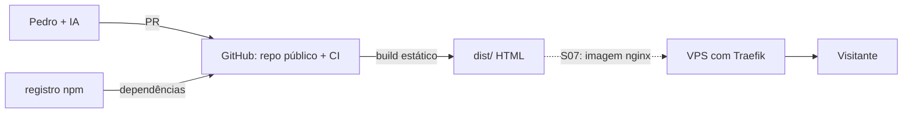

# Threat model (1 página): ailow-index (site estático público) — rev. 2026-11-18

*(Tier A com gates do B que cabem num site estático. Revisar quando entrar formulário, script de terceiro, API, cookie ou o deploy (S07). Fontes: ADR 001 e 002, `docs/excecoes.md`, `.github/workflows/ci.yml`, `src/changelog/`. O que não foi conferido está marcado "não verificado".)*

## 1. O que estamos construindo?
Site institucional da Ailow (`ailow.com.br`): páginas da marca e o portfólio `/pedro` contado como changelog. O build do Astro gera HTML estático; **não há API, banco, login, formulário, cookie nem dado de terceiro**. Previsto (S07): imagem nginx atrás de Traefik numa VPS, só com pedido do Pedro.

**Ativos:** (1) informação privada que pode vazar no conteúdo (**risco principal**: repositório e site são públicos); (2) integridade e credibilidade do conteúdo; (3) domínio e DNS; (4) repositório e CI (conta `ailowio`); (5) cadeia de dependências npm.
**Fronteiras de confiança:** autor (humano/IA) → repositório público · registro npm → build · CI → artefato publicado (S07) · internet → nginx.

## 2. O que pode dar errado?
| # | Ameaça | Categoria | Prob. | Impacto |
|---|--------|-----------|-------|---------|
| 1 | Conteúdo publica IP, segredo, fatura, nome de cliente/prospect ou projeto privado | Exposição de dados | M | A |
| 2 | Entrada não confirmada, ou feature inexistente, vai ao ar (credibilidade) | Integridade do conteúdo | M | M |
| 3 | Segredo commitado no repositório público ou no CI | Segredos | B | A |
| 4 | Dependência npm ou action com vulnerabilidade ou comprometida (supply chain) | Componente vulnerável | M | M |
| 5 | Alteração direta na `main` ou PR sem checks | Controle de mudança | B | A |
| 6 | Sequestro da conta GitHub ou do DNS/domínio | Acesso / disponibilidade | B | A |
| 7 | Site servido sem cabeçalhos de segurança (clickjacking, sniffing) | Configuração | M | B |
| 8 | Deploy sem aprovação ou imagem adulterada | Mudança em produção | B | A |

## 3. O que vamos fazer a respeito?
| # | Mitigação (situação real) | Regra | Evidência |
|---|---------------------------|-------|-----------|
| 1 | Linter de conteúdo que **falha o build** (IPv4, token, JWT, chave privada, fatura, grafia `ilo.`); lista local de nomes bloqueados **fora do git** (`*.local.txt` no `.gitignore`); template de PR com checklist de conteúdo público | SEC-05, SEC-16 | `src/changelog/bloqueio.ts`, `src/changelog/carregar-termos.ts`, `.gitignore`, `.github/pull_request_template.md` |
| 2 | Só `verificacao: confirmado` é publicado; `prova` obrigatória; número publicado nunca muda | DOC-*, ADR 002 | `src/changelog/regras.ts` (filtro por `confirmado`), `src/changelog/esquemas.ts`, `docs/adr/002-portfolio-como-changelog.md` |
| 3 | gitleaks no histórico inteiro (imagem por digest); secret scanning e push protection do GitHub ligados | SEC-05 | job `seguranca-segredos` em `.github/workflows/ci.yml`; push protection: configuração da plataforma, conferida pelo orquestrador em 2026-11-18 |
| 4 | `npm audit` bloqueante em produção; Semgrep (ERROR) no código próprio; Dependabot semanal; lockfile com `npm ci`; actions fixadas por SHA; permissões `contents: read` | SEC-10, CI-05/07 | jobs `seguranca-sca`, `seguranca-sast`; `.github/dependabot.yml`; exceção EX-02 em `docs/excecoes.md` |
| 5 | Ruleset `proteger-main` (id 27518794): PR obrigatório, checks `verify`/`seguranca-*` obrigatórios, sem force-push nem exclusão, sem bypass. Aprovação humana = 0 (EX-01) | CI-08, AUD-22 | configuração da plataforma (conferida em 2026-11-18); `docs/excecoes.md` EX-01 |
| 6 | MFA na conta `ailowio` e no registrador do domínio: **não verificado**. Registro e DNS: a registrar quando o deploy existir | AUD-01/03 | `docs/auditoria/matriz-acessos.md` |
| 7 | nginx com `server_tokens off`, `nosniff`, `X-Frame-Options DENY`, `Referrer-Policy`, `Permissions-Policy` e CSP estrita (`default-src 'self'`, scripts só por hash sha256 gerado do `dist/` no build, sem `unsafe-inline` em script; `style-src` mantém `unsafe-inline` porque o Astro inlina CSS e há `style=` em atributos: estilo não executa script, risco aceito); imagem `nginx-unprivileged` uid 101 na 8080; HSTS fica no Traefik; scan Trivy CRITICAL/HIGH no CI; orçamento de JS no `verify` | SEC-*, OPS-* | `ops/web/`, `Dockerfile`, `scripts/csp.mjs`, `test/imagem-nginx.test.ts`, `e2e/csp.e2e.ts`, job `imagem` do `ci.yml`. Servido em produção: **só após a S12** |
| 8 | Deploy só por workflow parado no approval do Environment; rollback por tag anterior | OPS-*, AUD-24 | **planejado, S07** |

## 4. Como saberemos que fizemos um bom trabalho?
Testes de bloqueio que **falham** quando o padrão é removido (`test/`, canário L-0006) · CI vermelho impede merge · alertas do Dependabot e do secret scanning sem pendência não documentada · E2E sem requisição a terceiros (S04).

## Riscos aceitos / em aberto (com dono e data de revisão)
| Risco | Decisão | Dono | Revisar |
|-------|---------|------|---------|
| Sem segunda pessoa para aprovar o PR (#5) | EX-01 | Pedro | 2027-02-18 |
| `picomatch` sem correção publicada, só no build (#4) | EX-02 | Pedro | 2026-12-18 |
| MFA da conta GitHub e do DNS não verificado (#6) | Pedro confirma e registra na matriz de acessos | Pedro | antes da S07 |
| Lista local de nomes bloqueados existe só na máquina do Pedro; sem ela, nomes de terceiros não são barrados (#1) | Aceito; a revisão humana do PR cobre o resto | Pedro | 2027-02-18 |
